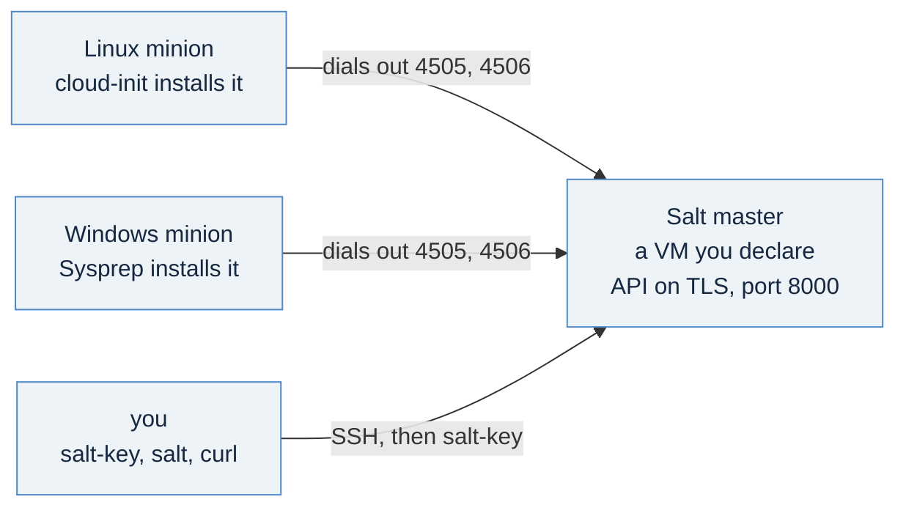

# Before you start: which Salt, and the shape of what you build

This folder is extra credit. Stage 02 of the [day-1 series](../day1-provisioning/README.md) ends with a machine that
configures itself once, at first boot, through cloud-init. Nothing in the series keeps that guest configured
afterwards. These pages do, with Salt, and nothing later in the handbook depends on them.

Read this page once. It answers the question that causes the most confusion, says what you need, and ends with one
read-only command that tells you whether your namespace can host the lessons.

## The one idea: there are three Salts, and you run only one of them

Every VCF 9.1 estate already shows a Salt master and Salt RaaS. It is tempting to point your workloads at them. Do not:
that Salt belongs to the platform. VMware's post of 2026-10-26, *From Open Source to Enterprise: Understanding the
VMware Salt API Evolution*, names three, and the [chapter](https://privatecloudarchitect.com/handbook/guest-configuration)
quotes each one's own words:

| Salt | What it is | Its endpoints | In these pages |
|---|---|---|---|
| **Salt Project** | "a free, community-driven configuration management and remote-execution tool" | whatever runs a minion | what you build: your own master, your own minions |
| **VMware Salt** | "available for VCF as an Advanced Service (licensed add-on)" | "customer workloads" | where to go when the free path's cost outgrows it |
| **VMware Salt for VCF Components** | "built into VMware Cloud Foundation architecture" | "VCF components only" | never a master for your workloads |

The free path has a real price, and VMware states it: open source suits "teams that need raw Salt automation and are
willing to build their own reporting, governance, and integrations around it". How the Advanced Service is sold is not
in the post; ask Broadcom.

## The shape: one master, minions that join it



A master is a platform service you run once; workloads join it for years. So you build the master first, on its own,
and every minion takes the master's address when it is created. Minions dial **out** to the master on 4505 and 4506,
inside the namespace's network, so those ports need no load balancer. Only the master's API (8000) and, for these
lessons only, its SSH port get one.

**The version.** Salt Project's lifecycle page, read 2026-11-09: 3008 LTS has active support to June 2027 and CVE support
to June 2028; 3006 LTS's active support ended July 2026. Everything here pins 3008 LTS (the point release 3008.5) and
installs it from Broadcom's package location with Salt's own apt pin.

## What you need

| You need | Why | How to check |
|---|---|---|
| A namespace you may build in, and a `kubectl` context for it | everything here is a `kubectl apply` | [day-1's page 00](../day1-provisioning/00-reaching-the-supervisor.md); `kubectl get vm` answers |
| An Ubuntu 24.04 image and a Windows Server 2022 image | the master and the Linux minion, the Windows minion | below |
| Room for three small machines | the master and two minions, `best-effort-small` and `best-effort-medium` | your namespace's quota |
| Outbound reach from the namespace to `packages.broadcom.com` and to your image's Ubuntu package mirrors | each machine installs Salt from the first and the install's prerequisites from the second at first boot | the master's first boot tells you (page 01) |
| An SSH key pair on your workstation | the lessons sign in to the master and the Linux minion | `ls ~/.ssh/id_ed25519.pub`, or `ssh-keygen -t ed25519` |
| `openssl` and `curl` | the API's certificate, and its first sign-in | both ship with macOS and most Linux |

## The discovery commands

Work from your namespace's context. Three reads tell you the values the templates ask for:

```bash
kubectl get virtualmachineclasses
kubectl get clustervirtualmachineimages,virtualmachineimages \
  -o custom-columns=ID:.metadata.name,NAME:.status.name | grep -v -- '-vkr\|-tkg\|ob-'
```

What they printed on the reference estate, 2026-11-12 (yours lists your own):

```
NAME                 CPU   MEMORY
best-effort-large    4     16Gi
best-effort-medium   2     8Gi
best-effort-small    2     4Gi
best-effort-xsmall   2     2Gi

ID                      NAME
vmi-9683a100a5077bb5d   ubuntu-24.04.3-LTS
vmi-b5a7e5ffc725053f3   ubuntu2402
vmi-cd18e639f6c3939df   Protection-and-Recovery-Proxy-9.1.1.0.25674358
vmi-d023c51f5b8a58694   windows2022
```

The `grep` drops the VKS node images, which carry a Kubernetes version in their names and are not for building a VM.
What is left still holds images that are not for these lessons, here a second Ubuntu and an appliance's image: pick the
Ubuntu 24.04 and the Windows Server 2022 by their names.
Pin the **NAME**, not the `vmi-` id: an id names a library item, and a rebuilt library gives every image a new one
([Content libraries](https://privatecloudarchitect.com/handbook/content-libraries)).

**If the class list is empty,** your namespace may still be in its `Creating` phase; read it again in a minute.

**The storage class** is the one value a tenant cannot list: `kubectl get storageclass` is refused. Read it from the
top-level context with `kubectl get regionstorageclassquotas`, or copy it from a machine already running in the
namespace, as [day-1's page 02](../day1-provisioning/02-your-first-vm-by-hand.md) shows.

## Two watch points

**A namespace that answers is not one that can build.** The first two reads succeed on a namespace with no quota left.
`guestcfg.py read` (the [harness](README.md#the-harness-guestcfgpy)) checks images, classes, storage, free space and
your rights in one read-only pass, and says what is missing before anything is made.

**Do not reuse the platform's Salt.** A namespace inside a VCF instance can reach the platform's own Salt master. It is
"VCF components only": a workload pointed at it is unsupported, and its key would sit beside the platform's own.

## Next

[`01-a-master-by-hand.md`](./01-a-master-by-hand.md): declare a Salt master, reach its API over TLS with an account
that can do only what you list, and sign in to it.
