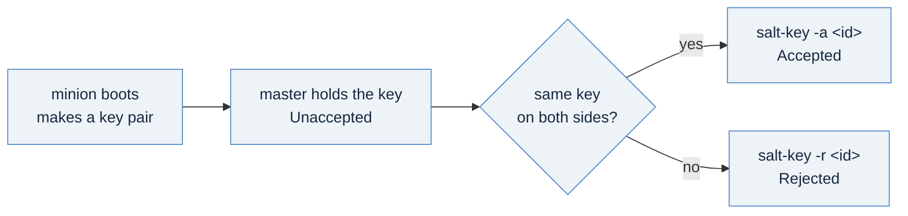

# One minion, and its key: trust an identity you checked

[01-a-master-by-hand](./01-a-master-by-hand.md) left you a master with no keys. This page builds one Linux minion, and
then does the thing that decides whether Salt is safe to run at all: it checks that the key waiting on the master is the
key the minion made, before accepting it. One wait, and one comparison you will make for every machine that ever
joins.

## The one idea

A minion is an identity, and its key is the proof of it. When a minion starts, it sends its public key to the master
and waits. The master holds the key as **unaccepted** until someone accepts it; from then on, anything that presents
that key under that id is that minion, and receives whatever the master sends it, secrets included.

So the acceptance is a trust decision. `salt-key -A` (accept all) makes it for every key at once, including a key from a
machine you have never heard of. These pages never use it. Accept **by exact id**, and only after you have compared the
key the master holds with the key the minion made, through a channel that is not Salt.



## Step 1: build the minion

The minion needs one value from the master: its address on the namespace's network, not the load balancer's.

```bash
kubectl get vm salt-master -o jsonpath='{.status.network.primaryIP4}{"\n"}'
```

```
192.0.2.66
```

Copy [`templates/02x-vm-salt-minion/salt-minion-linux.vm.yaml`](./templates/02x-vm-salt-minion/salt-minion-linux.vm.yaml)
as `minion-linux.yaml` and fill its four values: the master's address, the image, the storage class and your SSH public
key. Its id is its name, `salt-minion-linux`, which the master's API account already names.

```bash
kubectl apply -f minion-linux.yaml
```

```
secret/salt-minion-linux-bootstrap created
virtualmachine.vmoperator.vmware.com/salt-minion-linux created
```

## Step 2: watch the key arrive

```bash
ssh salt-operator@198.51.100.26 'sudo salt-key -L'      # the master, through its front door
```

The key arrives once the minion's first boot has installed Salt and started it; the harness allows 30 minutes. What
it printed on the reference estate, 2026-11-12:

```
Accepted Keys:
Denied Keys:
Unaccepted Keys:
salt-minion-linux
Rejected Keys:
```

An unaccepted key is harmless: the master sends it nothing. Leave it there until you have checked it.

## Step 3: compare the key itself, out of band

Read the key from each side, through SSH rather than through Salt. The minion is on the namespace's private network,
so reach it through the master (`-J`), using the minion's own address:

```bash
kubectl get vm salt-minion-linux -o jsonpath='{.status.network.primaryIP4}{"\n"}'      # 192.0.2.67 here

# the master's copy of the key it is holding
ssh salt-operator@198.51.100.26 \
  "sudo grep -v -- ----- /etc/salt/pki/master/minions_pre/salt-minion-linux | tr -d '\n' | sha256sum"

# the minion's own key, in its own pki_dir
ssh -J salt-operator@198.51.100.26 salt-operator@192.0.2.67 \
  "sudo grep -v -- ----- /etc/salt/pki/minion/minion.pub | tr -d '\n' | sha256sum"
```

What they printed on the reference estate, 2026-11-12:

```
c1311e9b9516b6a23cefbee82f710488fbd1a055c9db36c206402429432c4ab5  -
c1311e9b9516b6a23cefbee82f710488fbd1a055c9db36c206402429432c4ab5  -
```

**Equal: the same key.** Each command hashes the key's base64 body only, the lines between its `BEGIN` and `END`
markers joined into one, so the comparison is one line on each side and cannot be fooled by layout. If you would rather
read the key than its hash, `sudo salt-key -p salt-minion-linux` prints the master's copy and
`sudo cat /etc/salt/pki/minion/minion.pub` the minion's; the lines between the markers must match.

## Step 4: accept by exact id, and say hello

```bash
ssh salt-operator@198.51.100.26 'sudo salt-key -a salt-minion-linux -y'
ssh salt-operator@198.51.100.26 'sudo salt salt-minion-linux test.ping'
```

Shortened (the warning below left out):

```
The following keys are going to be accepted:
Unaccepted Keys:
salt-minion-linux
Key for minion salt-minion-linux accepted.
salt-minion-linux:
    True
```

`-a salt-minion-linux` accepts that one id and nothing else. Salt 3008.5 may also print
`[WARNING ] unclosed MasterEvent ...` after an accept; it is a message about Salt's own housekeeping, not about your key.

## Three things that will bite you

**The fingerprints Salt prints disagree, for the same key.** It is natural to compare `sudo salt-key -f salt-minion-linux`
on the master with `sudo salt-call --local key.finger` on the minion. On Salt 3008.5 they never match:

```
salt-minion-linux:  1c:94:82:99:96:f9:68:bc:c8:d1:78:52:a3:7a:86:3e:cc:cb:78:eb:0f:1c:5e:a7:ae:f0:9b:df:00:ec:1f:87
local:
    2a:d4:fe:ed:df:bd:12:a1:c0:ea:ad:72:a0:80:9d:bc:9f:0d:df:b8:8e:01:39:ad:ec:55:20:89:88:f6:b9:bf
```

The master hashes the whole stored file, markers included; the minion hashes only the lines inside. A raw
`sha256sum` of the two files differs too, because the master stores the key without its final newline. Hash the body,
as step 3 does, and the two sides agree (G-980).

**A second machine under the same id.** If a key arrives under an id that already holds one, accepted or still
waiting, Salt lists the newcomer as denied rather than replacing the first. Never accept your way out of that: find
the second machine. An id is an identity; two machines claiming one is an incident, not a typo.

**A ping right after the accept can miss.** A minion whose key is pending retries its sign-in every
`acceptance_wait_time` seconds, 10 by default on Salt 3008.5. In the VM Apps proof of these pages, a `test.ping` sent
at once after `salt-key -a` answered `Minion did not return. [No response]`, and the same ping sent again later
answered `True`. Give the minion that long before you read its silence as a fault.

## What you just did, and where it goes

| You did | Why it matters | In a pipeline |
|---|---|---|
| built a minion that names its master | the minion dials out; nothing reaches into it | the same template, through a blueprint (page 07) |
| left its key unaccepted until checked | the master sends an unaccepted key nothing | the same; never `auto_accept` |
| compared the key's body hash on both sides | trust is a comparison you made, out of band | a key generated on the master and seeded at create needs no comparison: `salt-minion-linux.blueprint.yaml` takes one |
| accepted by exact id | one decision, one machine | the API's `key.accept` with a match of one id |

## Next

[`03-your-first-state.md`](./03-your-first-state.md): declare what the minion should hold, apply it, and apply it again.
