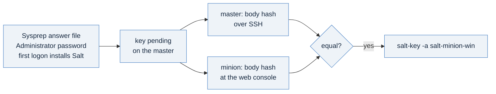

# A Windows minion: the same state, and a key you check at the console

[04-drift](./04-drift.md) finished the Linux minion's lessons. This page joins a Windows Server 2022 minion to the same
master and applies the same state to it, unchanged. The minion goes through the same three steps as the Linux one:
it names its master, its key waits on the master, and you compare that key before you accept it. What differs is the
way in, and the wait.

## The one idea

On Windows the first boot is Sysprep, not cloud-init, and its one login is the Administrator password you write into
the answer file. There is no SSH. So the channel that is not Salt is the machine's **console**: you open it, sign in
as Administrator, and read the key there. The state needs no change at all: page 03's `init.sls` chose its path from
the `os_family` grain, so on this minion it manages `C:\ProgramData\guestcfg\managed.conf`.



## Step 1: make the Administrator password

In the same working folder as page 01's files:

```bash
( umask 077; openssl rand -base64 16 | tr -d '=\n' > win.password )
```

Twenty-two characters of letters, digits, `+` and `/`. Sysprep takes the password in plain text, so the Secret that
carries it is as sensitive as the password: generate one for this machine, and never reuse it.

## Step 2: fill the template

Copy [`templates/02x-vm-salt-minion/salt-minion-windows-sysprep.vm.yaml`](./templates/02x-vm-salt-minion/salt-minion-windows-sysprep.vm.yaml)
as `minion-win.yaml` and fill its values:

| Placeholder | Fill with |
|---|---|
| `&lt;REPLACE_ME-administrator-password&gt;` (twice) | the contents of `win.password` |
| `&lt;REPLACE_ME-master-ip&gt;` | the master's own address, `192.0.2.66` here, as on page 02 |
| `<REPLACE_ME-windows-2022-image>` | the Windows image's display name from page 00, such as `windows2022` |
| `<REPLACE_ME-storage-class>` | your storage class |

**The first three sit inside XML,** the answer file, so their angle brackets are written `&lt;` and `&gt;`. Replace
the whole placeholder, those six characters at each end included. The password from step 1 needs no escaping: it holds
no `&`, `<` or `>`.

Leave the `{{ V1alpha5_... }}` values as they are. VM Operator fills them with the machine's own network when it
customizes the guest. The minion's id is its name, `salt-minion-win`, which page 01's API account already names.

## Step 3: prove it, then build it

```bash
kubectl apply -f minion-win.yaml --dry-run=server
kubectl apply -f minion-win.yaml
```

```
secret/salt-minion-win-bootstrap created (server dry run)
virtualmachine.vmoperator.vmware.com/salt-minion-win created (server dry run)
secret/salt-minion-win-bootstrap created
virtualmachine.vmoperator.vmware.com/salt-minion-win created
```

Windows takes longer than Linux. Sysprep customizes the machine before it has an address, and only then does the
first logon download and install Salt 3008.5 and start the minion. The harness allows a Windows machine 30 minutes
for its address and 60 for its key.

## Step 4: read the master's copy of the key

```bash
ssh salt-operator@198.51.100.26 'sudo salt-key -L'
ssh salt-operator@198.51.100.26 \
  "sudo grep -v -- ----- /etc/salt/pki/master/minions_pre/salt-minion-win | tr -d '\n' | sha256sum"
```

What they printed on the reference estate, 2026-11-12:

```
Accepted Keys:
salt-minion-linux
Denied Keys:
Unaccepted Keys:
salt-minion-win
Rejected Keys:
3b928b6b4e763287f5e5ecb1faca3fc0811e38460374993c818b907f16e159be  -
```

## Step 5: read the minion's own key at its console

From your namespace's `vcf` context, the one [day-1's page 00](../day1-provisioning/00-reaching-the-supervisor.md)
gave you, ask for the machine's web console:

```bash
vcf context use <context-name>:<namespace>:<project>
vcf vm web-console salt-minion-win
```

Its help says it requests "a URL which can be opened in a web browser to access a VM's web console". Open it, sign in as
`Administrator` with the password from step 1, open PowerShell as administrator, and run this one line. It does what page 02's command did on Linux: it joins the key's base64 lines, the
ones between its `BEGIN` and `END` markers, and hashes them.

```powershell
$b = (Get-Content 'C:\ProgramData\Salt Project\Salt\conf\pki\minion\minion.pub' | Where-Object { $_ -notmatch '-----' }) -join ''; [BitConverter]::ToString([Security.Cryptography.SHA256]::Create().ComputeHash([Text.Encoding]::ASCII.GetBytes($b))).Replace('-','').ToLower()
```

```
3b928b6b4e763287f5e5ecb1faca3fc0811e38460374993c818b907f16e159be
```

**Equal to the master's: the same key.** What the proof did and did not do here. It did not run `vcf vm web-console`
on this minion: its namespace was made by the proof's own runner, so no `vcf` context named it. It made the same
console request by hand on another machine, and the platform answered with a console ticket, but the reference
workstation had no route to the Supervisor's address on port 443, which serves the console page, so no console was
opened (G-987). The hash above is the same line run through Salt after the key was accepted. That proves what the line
prints, not the key, as the next box explains. On a VM Apps organization the same line ran over the Administrator's own
sign-in before the accept, and matched ([`vm-apps/README.md`](vm-apps/README.md)).

## Step 6: accept by exact id, and apply the same state twice

```bash
ssh salt-operator@198.51.100.26 'sudo salt-key -a salt-minion-win -y'
ssh salt-operator@198.51.100.26 'sudo salt salt-minion-win state.apply guestcfg'
ssh salt-operator@198.51.100.26 'sudo salt salt-minion-win state.apply guestcfg'
```

What they printed, shortened:

```
The following keys are going to be accepted:
Unaccepted Keys:
salt-minion-win
Key for minion salt-minion-win accepted.

          ID: guestcfg-managed-file
    Function: file.managed
        Name: C:\ProgramData\guestcfg\managed.conf
      Result: True
     Comment: File C:\ProgramData\guestcfg\managed.conf updated
Succeeded: 1 (changed=1)

          ID: guestcfg-managed-file
    Function: file.managed
        Name: C:\ProgramData\guestcfg\managed.conf
      Result: True
     Comment: File C:\ProgramData\guestcfg\managed.conf is in the correct state
Succeeded: 1
```

The same state on both systems, a path from the grain, and a second apply that changes nothing.

## Three things that will bite you

**A check you run through Salt after accepting proves nothing about the key.** Once a key is accepted, Salt runs a command on
whichever machine holds that key. If a machine other than yours had sent the key, it would also answer with its own
key's hash, and the two would match. The comparison counts only before acceptance, through a channel that is not Salt.
If you cannot reach the console, you have two honest choices: get a route to the Supervisor's console address, or
accept by exact id with the key arriving minutes after your create and no other key pending. The second choice trusts
the namespace's network for those minutes, and you should say so to whoever owns the machine.

**A name over 15 characters.** The machine's name becomes its Windows host name, and on the Sysprep path VM Operator
refuses a name longer than 15 characters at the apply (G-970). `salt-minion-win` is 15.

**Commands in the answer file start together.** The template's two first-logon commands install Salt and then sign
the Administrator session out. Windows starts them at the same time, whatever their `Order`, so the sign-out waits for
the minion service and the installer before it acts. If you add a command, make it wait for what it needs, and keep
each one to 1,024 characters at most (G-983).

## What you just did, and where it goes

| You did | Why it matters | In a pipeline |
|---|---|---|
| wrote a password into a Sysprep answer file | Sysprep's only login, in plain text in a Secret | a blueprint input, encrypted (page 07) |
| compared the key's body hash at the console | the one channel to a Windows minion that is not Salt | the same comparison, or acceptance by exact id with its trust stated |
| applied an unchanged state to Windows | one state for both systems, the path from a grain | the same `guestcfg` state, from the same master |

## Next

[`06-retire-a-minion.md`](./06-retire-a-minion.md): take it all down in the order that leaves no trust behind.
