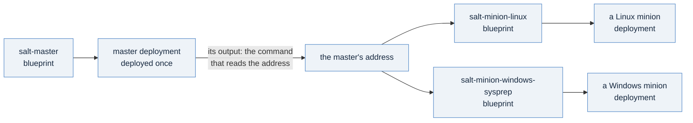

# The same, as blueprints: the master once, minions that take its address

[06-retire-a-minion](./06-retire-a-minion.md) took everything down. Pages 01 to 06 built it with `kubectl apply`, which
is how you learn it. This page turns the same three machines into VCF Automation blueprints, which is how an
organization runs it: a catalog item a project can request, inputs in place of the values you typed, and a deployment
that records what was built and is the one thing you delete.

## The one idea

A blueprint is the by-hand file with its values turned into inputs. There are three blueprints, not one, because the
machines do not live the same life. The master is a platform service: you deploy it once, and it outlives everything
that joins it. Each minion is its own deployment, and it takes the master's **address** as an input. So a workload team
can request a minion, and later delete it, without ever touching the master.



## Step 1: read what each blueprint asks for

Everything you filled by hand on pages 01, 02 and 05 is an input now. Read the three files in
[`templates/02x-vm-salt-minion/`](./templates/02x-vm-salt-minion/) beside this table; each input's description says how
to make its value.

| You filled by hand | The input | In |
|---|---|---|
| the image, the storage class, the class | `vm_image`, `storage_class`, `vm_class` | all three |
| the namespace you worked in | `target_namespace_name` | all three |
| the two minion ids the API may reach (page 01) | `linux_minion_id`, `windows_minion_id` | the master |
| the API password's digest (page 01) | `api_digest_b64`, **encrypted** | the master |
| `api.crt` and `api.key` (page 01) | `api_tls_cert_b64`, and `api_tls_key_b64`, **encrypted** | the master |
| nothing: who may reach the API | `api_source_ranges`, a list of CIDRs | the master |
| the master's own address (pages 02 and 05) | `salt_master_address` | both minions |
| the Administrator password (page 05) | `admin_password`, **encrypted** | the Windows minion |
| nothing: a key made on the master | `minion_pem_b64`, **encrypted**, and `minion_pub_b64`, both optional | the Linux minion |
| your SSH key, for the `salt-operator` login | nothing: the blueprints carry no login | |

**Each certificate, key and digest is one line of base64.** A value with line breaks, put into the cloud-config, would
have to match its indentation (page 01's warning about pasting a PEM). One line of base64 cannot break it, and the
guest decodes it. The master blueprint's header gives the three commands:

```bash
openssl base64 -A -in api.crt          # api_tls_cert_b64
openssl base64 -A -in api.key          # api_tls_key_b64
printf 'guestcfg-api:%s\n' "$(printf '%s' "$(cat api.password)" | sha256sum | cut -d' ' -f1)" \
  | openssl base64 -A                  # api_digest_b64; on macOS, shasum -a 256 for sha256sum
```

An input marked `encrypted: true` is stored by the platform as a secret, and the request form masks it.

## Step 2: deploy the master, then read its address

Load the blueprints the way [day-1's stages](../day1-provisioning/README.md) load theirs: import each as a template in
your project, release a version, and add it to your project's catalog. Then request the master first. When its
deployment is `CREATE_SUCCESSFUL`, its outputs hold the two commands you ran by hand on pages 01 and 02:

```bash
kubectl get virtualmachine <app_name>-master -n <namespace> -o jsonpath='{.status.network.primaryIP4}'       # read_the_master_address
kubectl get virtualmachineservice <app_name>-api -n <namespace> -o jsonpath='{.status.loadBalancer.ingress[0].ip}'   # read_the_api_address
```

Sign in to the API exactly as on page 01, step 5, at the second address. Then request each minion with the first
address as its `salt_master_address`. The proof ran these three blueprints through the harness, step 3, and not
through a catalog form.

## Step 3: let the harness make the same requests, and read them

The [harness](README.md#the-harness-guestcfgpy) does steps 1 and 2 through VCF Automation's API. With the deployed
machines it then accepts each key by its exact expected id, page 02's acceptance without page 02's comparison, since the
harness has no channel to a minion that is not Salt, and runs pages 03, 04 and 06. It creates the three blueprints in your project from these files as written, validates
each, deploys the master, reads its address, deploys both minions with it, and at the end deletes the deployments and
the blueprints. Prove it first, then run it:

```bash
export GUESTCFG_VIA=automation GUESTCFG_PROJECT=<the-project-holding-the-namespace>
export GUESTCFG_API_SOURCE_RANGES=<your-workstation-address>/32
python3 guestcfg.py run --dry-run       # the blueprints, deployments and objects it would make; nothing made
python3 guestcfg.py run --execute
```

What run A5 printed on the reference estate, 2026-11-11, from step 2 to the end, with its probes' lines left out (the
whole run is in [`expected-output.md`](expected-output.md)). It ran with no source ranges set, so the API's input was
`0.0.0.0/0`:

```
step 2: the master, through VCF Automation
  3 blueprints created in the project from the files as written
  each validated with no error: salt-master.blueprint.yaml, salt-minion-linux.blueprint.yaml, salt-minion-windows-sysprep.blueprint.yaml
  deployment guestcfg-906e54-master CREATE_SUCCESSFUL after 110s
  master PoweredOn with an address after 6s more, read from the namespace
  load balancer for port 8000 has an address after 6s
  Salt API answered over TLS pinned to the run's certificate after 92s
  the load balancer carries loadBalancerSourceRanges 0.0.0.0/0
step 3: the minions, through VCF Automation
  Windows path: Sysprep (rawSysprep)
  deployments guestcfg-906e54-linux and gc-906e54-win CREATE_SUCCESSFUL after 47s and 0s more
  Linux minion PoweredOn with an address after 47s
  Windows minion PoweredOn with an address after 54s
step 4: key acceptance, by exact expected id
  accepted exactly the 2 expected ids after 78s
step 5: ping, grains, one state, applied twice
  test.ping: 2 minions answered after 56s
  grains: Debian and Windows, Salt 3008.5
  the first apply changed the managed file; the second apply changed nothing, on both
step 6: drift named, then corrected
  on both minions: test=True named the drift, an apply restored it, and test=True afterwards reported nothing to change
step 7: retirement, in order: keys, the minion deployments, the master's, the blueprints
  teardown: 3 deployment(s) deleted through VCF Automation, minions first; 3 blueprint(s); keys: deleted; residue: none
step 8: read back
  nothing this run created is still here
wrote guestcfg.json: outcome complete
exit 0
```

Read it against the pages. Step 4 is page 02's acceptance by exact id, without the comparison. Step 5 is page 03's two applies, on both
systems. Step 6 is page 04, and step 7 is page 06's order, done through the deployments. The three blueprints were run
as they stood on 2026-11-11. Since then their comments and one output's description have changed, and the Linux
install now deletes its copy of a seeded key before any step that can exit.

## Step 4: retire through the deployments

Retire in page 06's order, through VCF Automation: delete each minion's key on the master, then delete the minions'
deployments, then the master's. A deployment's **Delete** removes what the deployment made: in run A5 the
namespace, read by the run's label afterwards, held nothing the deployments had made. Never delete the objects
underneath a deployment with `kubectl`. The harness's supervisor-path teardown refuses to, and says to delete through
the deployment instead.

## Three things that will bite you

**A source range is not a control until your load balancer proves it is.** `api_source_ranges` reaches the load
balancer's `loadBalancerSourceRanges` unchanged. VM Operator's reference says the field is ignored when the provider
does not support it, and on the load balancer the companion's proof used, a range that excluded the client did not stop
it (G-981). Limit port 8000 at your network's edge, and prove your own load balancer with the harness's
`GUESTCFG_PROVE_SOURCE_RANGES=1` on the supervisor path.

**No login means no comparison by hand.** The blueprints carry no `salt-operator` login, so pages 02 and 05's
comparison needs a way in that the blueprint does not give. On this path trust is acceptance by exact id, or, for
Linux, the stronger form: a key pair made on a master before the minion exists, passed as `minion_pem_b64` and
`minion_pub_b64`, so the key is accepted from the start and never pending. The blueprint master cannot do this as
shipped: its API grant leaves out `key.gen_accept`, and with no login nothing can place a public key in its accepted
folder. To use the two inputs, add `key.gen_accept` to the master's grant, call it for the minion's id before the minion
exists, and pass the pair it returns; the harness does exactly this on the supervisor path (`GUESTCFG_KEYS=preseed`). Whoever can read that minion's bootstrap Secret holds its identity, so keep that access as
tight as the key.

**A master's grant that never grows.** The master's API account names exactly the minion ids it was deployed with. A
master that minions join for years needs its grant edited as each one joins. No run of the companion did that, so
treat it as your own change, and prove it before you rely on it.

## What you just did, and where it goes

| You did | Why it matters |
|---|---|
| mapped every by-hand value to an input | a catalog form asks for exactly what you once typed, and masks the secrets |
| deployed the master once, and the minions with its address | a platform service and its workloads, each with its own life |
| read a complete run through VCF Automation | what a working pipeline prints, to compare yours with |
| retired through the deployments | the deployment is the record; delete through it |

## Where to go from here

- **Run the harness end to end** on the supervisor path too, with a key generated on the master
  (`GUESTCFG_KEYS=preseed`): the [harness section](README.md#the-harness-guestcfgpy) lists every setting.
- **When the free path's cost outgrows it,** with reporting, governance and integrations you would otherwise build
  yourself, read about VMware Salt, the licensed Advanced Service, in the
  [chapter](https://privatecloudarchitect.com/handbook/guest-configuration).
